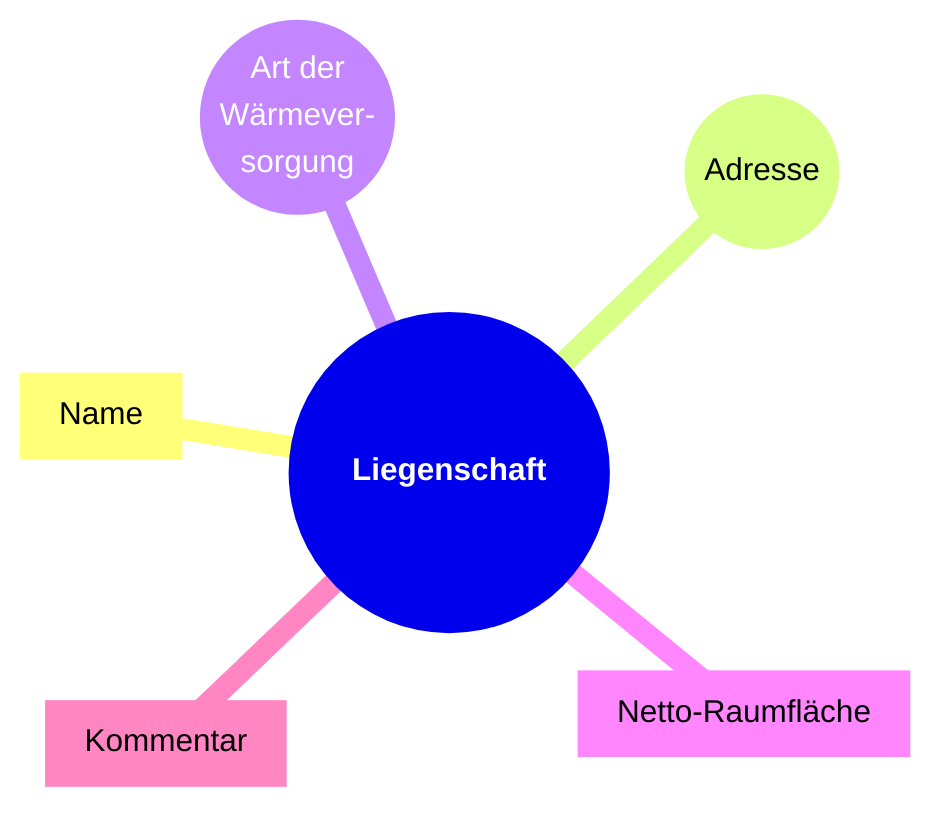
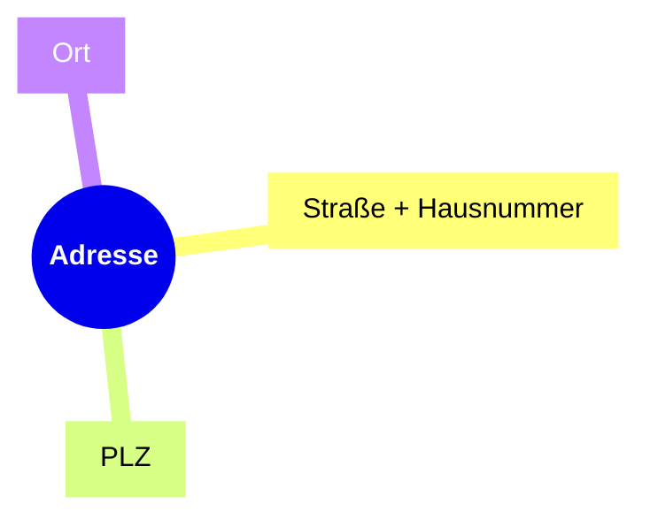
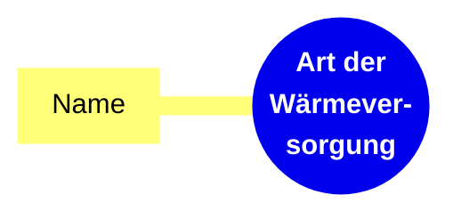
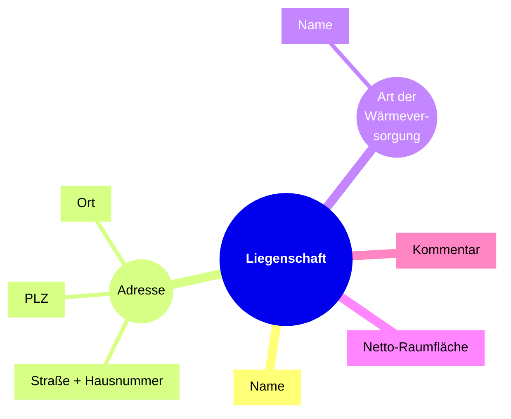
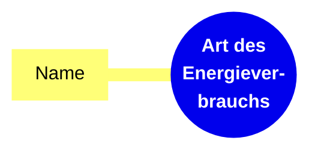
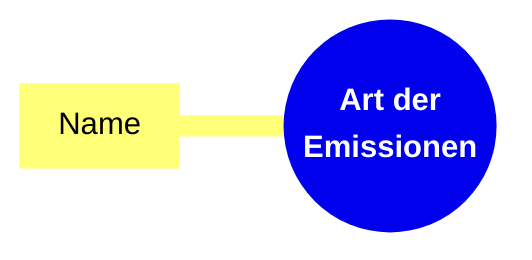
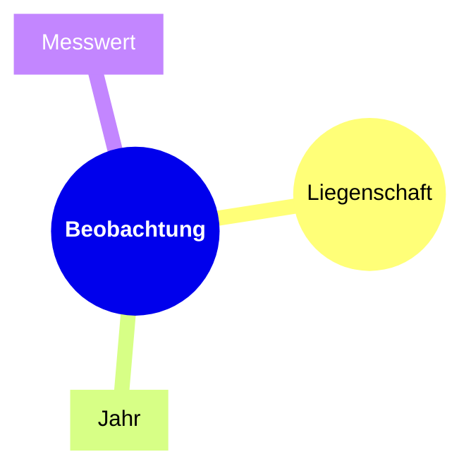
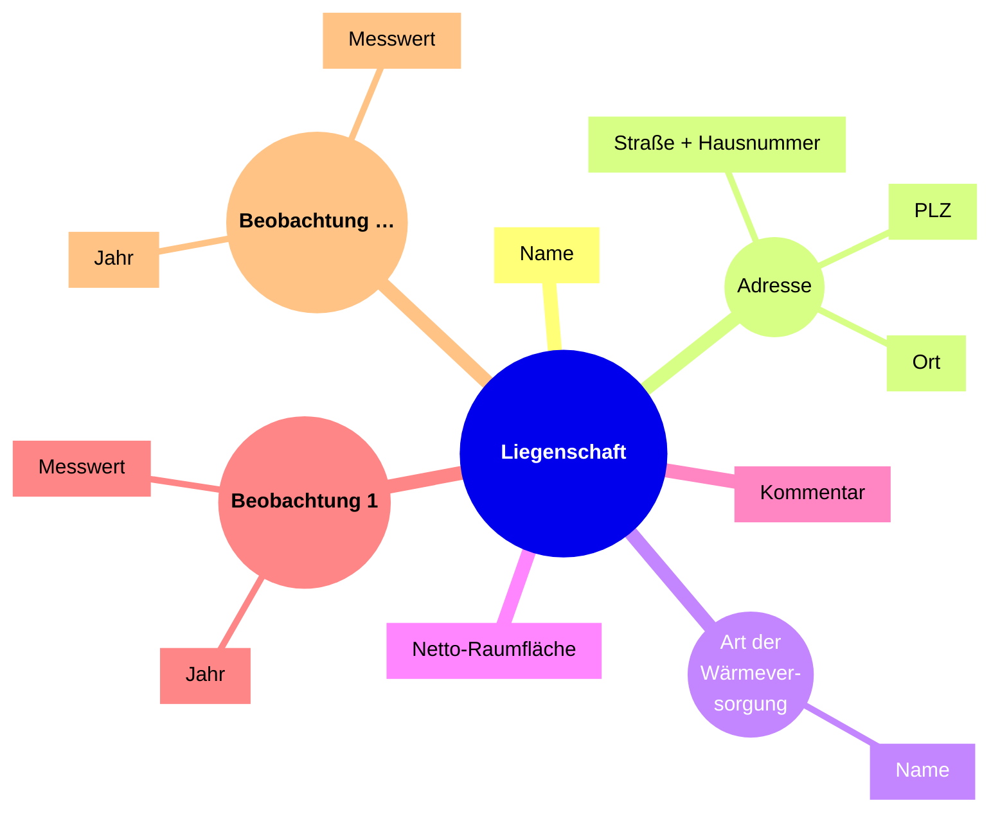

# Konvertierung einer CSV-Datenquelle zu Linked Data

Grundsätzlich müssen bei einem Linked-Data-Projekt, das aus einer beliebigen Datenquelle Linked Data erzeugen soll, die folgenden Schritte durchlaufen werden:

1. [Analyse der Quelldaten](#analyse-der-quelldaten) (CSV, JSON, RDB etc.)
2. [Modellierung der Zieldaten](#modellierung-der-zieldaten) (RDF)
3. [Umsetzung der Konvertierung](#umsetzung-der-konvertierung) von Quelldaten → Zieldaten
4. [Veröffentlichung der Daten](#veröffentlichung-der-daten)

Jeder dieser Schritte wird im folgenden behandelt.

## Analyse der Quelldaten

Die Analyse der Quelldaten soll zu einem besseren Verständnis der Daten führen.
Wie genau die Analyse aussieht, hängt stark von dem einzelnen Use-Case ab, aber folgende Fragen können ein guter Ausgangspunkt sein:

- *Welche Art von Daten*? Statistische Daten, hierarchische Daten (Organigramme etc.), Auflistungen (z.B. Liste aller Glascontainer) etc.
- *Welche Arten/Klassen von Entitäten* (oder einfach: Dinge) kommen in den Daten vor? “Bezirke”, “Berufe”, “Wirtschaftszweige”, “Geschlechter” etc.
- Innerhalb dieser Klassen: gibt es *konkrete Beispiele*?
- *Werden in den Daten Codes oder Ids genutzt*? Wenn ja, sind diese irgendwo definiert und veröffentlicht (z.B. als Teil eines Standards)?
-* Welche Eigenschaften der Entitäten* sind enthalten (Namen, Beginn, Ende, Adresse, Größe, Umfang, Wert etc.)
- *Welche Beziehungen bestehen zwischen den Entitäten* (Nachfolger, übergeordnet, innerhalb, außerhalb etc.)

Die Quelldaten im Beispiel sind Energieverbrauchsdaten für Gebäude/Liegenschaften des Berliner Bezirls Tempelhof-Schöneberg aus den Jahren 2019–2023.
Die Daten liegen in einer einzelnen Tabelle in Form einer CSV-Datei [ba-ts_verbrb-2019_2023.csv](/data/source/ba-ts_verbrb-2019_2023.csv) vor.
Als ersten Schritt schauen wir uns genauer an, welche Spalten in der Tabelle enthalten sind.

| Spaltenname | Daten | Kommentar |
| ----------- | ----- | --------- |
| lfd. Nr. | Laufende Nummer, Ganzzahl, beginnend bei 1 | Handelt es sich um eine stabile Id aus einem anderen System? Oder ist es einfach nur eine Nummer, die zufällig beim Erstellen der Tabelle angelegt wurde? |
| Liegenschaft | Name der Liegenschaft bzw des Gebäudes | nicht einzigartig / "unique": ist das ein Datenfehler oder so gewollt? |
| Strasse, Haus-Nr. | | |
| PLZ | | |
| Ort | | |
| Art der Wärmeversorgung | [ "Gas, Ölheizung", "Fernwärme", "Gas", "Nahwärme", "Speicherheizung", "Strom (WP)", "Stromheizung (kein Speicher)", "keine Angabe", "Ölheizung" ] | | 
| NRF Summe Gebäude | Ganzzahl | |
| Verbrauch Wärme (witterungsbereinigt)  2019 [kWh/a] | Ganzzahl | |
| … |
| Verbrauch Wärme (witterungsbereinigt)  2023 [kWh/a] | Ganzzahl | |
| Strom 2019 [kWh/a] | Ganzzahl | |
| … |
| Strom 2023 [kWh/a] | Ganzzahl | |
| CO2-Emissionen (Gesamt) 2019 [t/a] | Ganzzahl | |
| … |
| CO2-Emissionen (Gesamt) 2023 [t/a] | Ganzzahl | |
| Bemerkungen | Freitext | |

### Welche Art von Daten?

Daten können durchaus eine Kombination von verschiedenen Datenarten sein.
So sind die Daten im Beispiel etwa eine Kombination aus **Auflistung** und **statistischen Daten**:

- eine Auflistung aller Liegenschaften in Tempelhof-Schöneberg
- statistische Beobachtungen zu Wärmeverbrauch, Stromverbrauch und CO2-Emissionen, jeweils mit den Dimensionen Ort (Liegenschaft) und Zeit (Jahr) und der gemessene Wert.

### Welche Arten/Klassen von Entitäten kommen in den Daten vor?

Jede Zeile der Daten enthält verschiedene Verbrauchswerte für ein **Gebäude** (oder allgemeiner: eine Liegenschaft).
Für jedes Gebäude ist u.a. eine **Adresse** und die **Art der Wärmeversorgung** angegeben.
Schließlich gibt es unterschiedliche **Energieverbrauchsarten** (Wärme, Strom) und **Emissionen**.

Nicht zu vergessen: **statistische Beobachtungen**!

Man könnte natürlich noch weiter ins Detail gehen, aber für's erste reicht das.

Folgende Klassen von Entitäten kommen also vor:

- Gebäude/Liegenschaft
- Adresse
- Art der Wärmeversorgung
- Art des Energieverbrauchs
- (Art der) Emissionen
- statistische Beobachtungen

### Welche Eigenschaften der Entitäten sind enthalten?

#### Gebäude / Liegenschaften

Für jedes Gebäude sind folgende Eigenschaften angegeben:

- Name
- Adresse (Straße, Hausnummer, PLZ und Ort)
- Art der Wärmeversorgung 
- Netto-Raumfläche (NRF) in $m^2$
- optional ein Kommentar

Visuell könnte man das folgendermaßen darstellen:



#### Adressen

Adressen haben selbst auch Eigenschaften, bzw. Bestandteile:

- Straße + Hausnummer
- PLZ
- Ort

Visuell:



#### Art der Wärmeversorgung

Über die Art der Wärmeversorgung steht in den Daten nichts weiter.
Wir erfahren lediglich, dass es unterschiedliche Arten gibt, und wie sie heißen:

- Name



Liegenschaften mit Adressen + Art der Wärmeversorgung:



#### Art des Energieverbrauchs

Zwar kommen keine unterschiedlichen Energieverbauchsarten als Werte in den Zellen der Tabelle vor (wie bei der *Art der Wärmeversorgung*).
Über die Spaltenüberschriften erfahren wir aber, dass es unterschiedliche Arten gibt, nämlich Strom und Wärmeverbrauch.
Der Name ist also implizit als Teil der Spaltenüberschrift angegeben.

- Name




#### (Art der) Emissionen

In den Daten kommen nur CO2-Emissionen vor.
Es sind aber natürlich auch andere Arten von Emissionen denkbar, die jeweils einen anderen Namen haben.
Der Name ist also auch hier implizit als Teil der Spaltenüberschrift angegeben.

- Name



#### Statistische Beobachtungen

Jede Beobachtung ist definiert durch drei Dimensionen:

- Gebäude
- Jahr
- Messwert



Die Beobachtungen zusammen mit den Schuldaten:




## Modellierung der Zieldaten

### Datenmodel ohne Vokabulare

Das Datenmodel für die Schuldaten (ohne statistische Beobachtungen), ohne Vokabulare:


---

Datenmodel mit statistischen Beobachtungen, ohne Vokabulare:


### Datenmodell mit Vokabularen

- Statistische Daten:
  - [Cube Schema](https://cube.link)
  - [The RDF Data Cube Vocabulary](https://www.w3.org/TR/vocab-data-cube/)
- Adressdaten:
  - [schema.org](https://schema.org/PostalAddress)
  - [vCard](https://www.w3.org/TR/vcard-rdf/)


## Umsetzung der Konvertierung

- [Python-Skript](bin/convert.py)

```
$ python bin/convert.py --input data/source/ba-ts_verbrb-2019_2023.csv > data/target/example_01.ttl
```


## Validierung der Daten

- [SHACL-Shape](data/shacl/floor_area_cardinality_1.ttl)

```
$ pyshacl -s data/shacl/floor_area_cardinality_1.ttl data/target/example_01.ttl
```

- finow-grundschule
- friedenauer-gemeinschaftsschule
- grundschule-auf-dem-tempelhofer-feld
- gustav-heinemann-schule
- kathe-kollwitz-grundschule
- luise-henriette-oberschule
- robert-blum-oberschule
- sophie-scholl-schule
- ulrich-von-hutten-oberschul


## Veröffentlichung der Daten